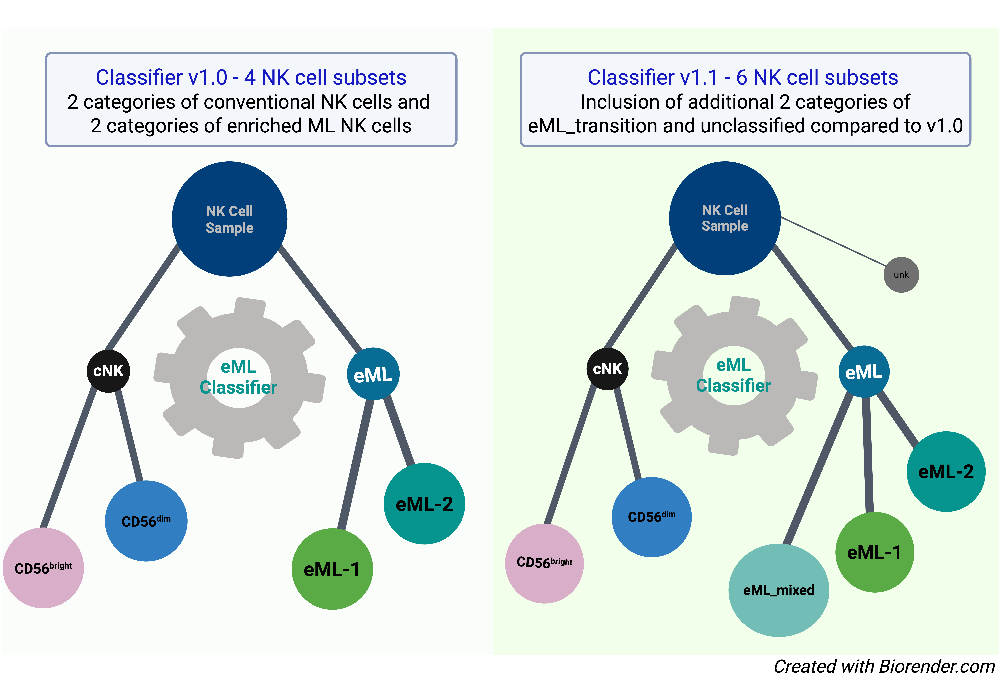
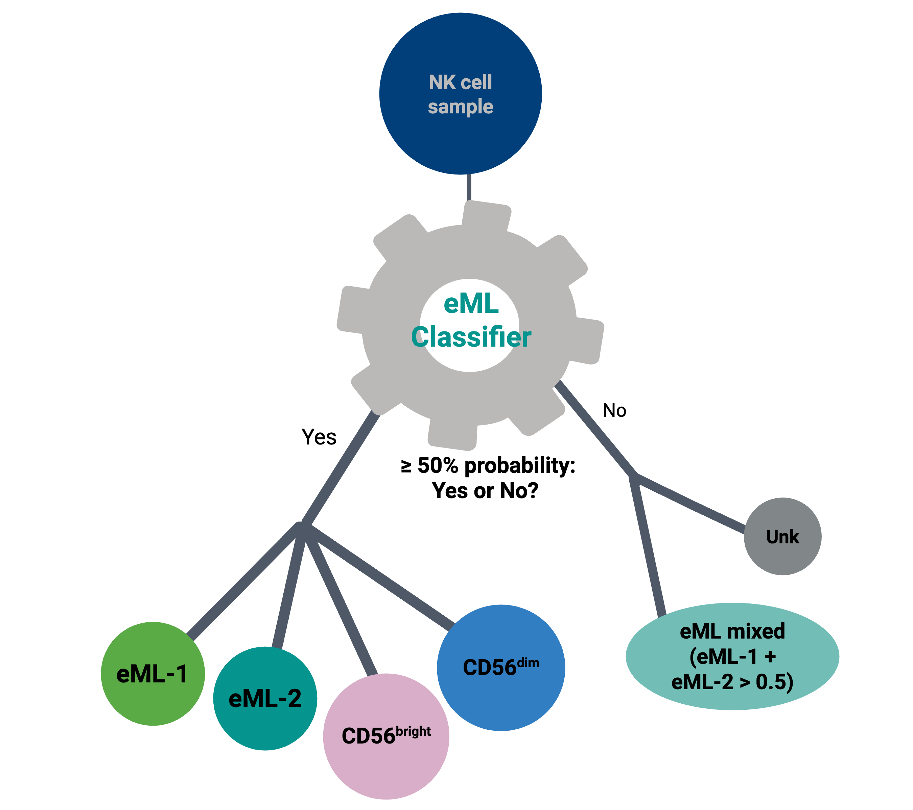

Outline
=======

Natural Killer (NK) cells, when activated by the cytokines IL-12, IL-15, and IL-18, do not uniformly transition into cytokine induced memory-like (ML) states, as previously assumed. A recent study (`Foltz`:sup:`*`, `Tran`:sup:`*` et al., 2024 (https://doi.org/10.1126/sciimmunol.adk4893)) demonstrated that such stimulation leads to heterogeneous NK cell fates, which include effector cytokine-primed NK (effcNK) cells and a distinct enriched memory-like (eML) NK population marked by enhanced IFN-γ production. 

Building on these findings, we developed a machine learning classifier (Classifier Version 1.0) using CITE-seq data to enable unbiased and accurate identification of conventional NK cells and enriched ML NK cells. Classifier Version 1.1, presented here, extends this original model (classifier Version 1.0) by introducing two additional categories: eML_mixed and unclassified. These additions allow for refined classification of NK cells that do not meet the strict assignment thresholds used in the original classifier.

This is performed by classify cells( ) function,  which classifies each cell as:

1.  Assigns the label with the highest probability for the cell if any probability exceeds 0.5.

2. ``eML_mixed``: If both eML1 and eML2 combined have a probability > 0.5 but none of the individual types exceed 0.5,

3. ``unclassified``: If all probabilities are below 0.5

Explanation of the Classifier
-----------------------------
Classifier includes a pipeline for processing single-cell multi-omics data (RNA +/ protein) using the scvi-tools framework, particularly the TOTALVI model, to classify NK cells. 
The purpose of this classifier is to 

1. Loads a dataset of RNA counts, metadata and (optionally) protein expression.Aligns it with a reference dataset trained with TOTALVI.

2. Classifies cells into NK cell subtypes using a pretrained classifier, BBC (Balanced Bagging Classifier).

3. Saves results including probabilities and updated data objects.

The following root structure  includes various components of the classifier and how each part contributes to its functionality. 
This includes data preprocessing, model training, and classification steps.

Root Structure
--------------

- **Import Libraries**

  - System & OS: ``argparse``, ``os``, ``sys``, ``warnings``
  - Data Handling: ``numpy``, ``pandas``, ``anndata``, ``scanpy``
  - Deep Learning: ``torch``, ``scvi``, ``TOTALVI``
  - Networking: ``requests``

- **Argument Parsing**

  - ``parse_arguments()`` – Handles command-line arguments

- **Functions**

  - **Download & File Handling**

    - ``get_model_path()`` – Retrieves correct reference files paths
    - ``validate_files()`` – Ensures required input files exist
    - ``validate_data_integrity`` - Validates if the number of lines and barcodes match between RNAcounts and ADT data
    - ``load_proteins_from_file()`` – Loads protein names from a file

  - **Data Loading & Processing**

    - ``load_data()`` – Loads AnnData object and external data
    - ``preprocess_data()`` – Prepares data for TOTALVI processing
    - ``integrate_protein_data()`` – Aligns protein expression data
    - ``initialize_protein_data()`` – Sets up a zero-filled protein matrix
    - ``prepare_adata_for_totalvi()`` – Final preprocessing for TOTALVI
    - ``align_protein_data()`` – Ensures query protein expression matches reference

  - **Model Training & Classification**
  
    - ``train_totalvi_model()`` – Loads & trains TOTALVI model
    - ``classify_latent_space()`` – Uses BBC classifier for predictions
    - ``save_results()`` – Saves classification results and trained model
    - ``classify_cells()`` – Assigns NK cell types based on probabilities

- **Main Execution**

  - Parses user arguments
  - Loads and preprocesses data
  - Trains TOTALVI model
  - Classifies latent space and saves results

.. image:: images/TotalVI_functions_1.png
   :alt: Description of the image
   :align: center
   :width: 1000px

